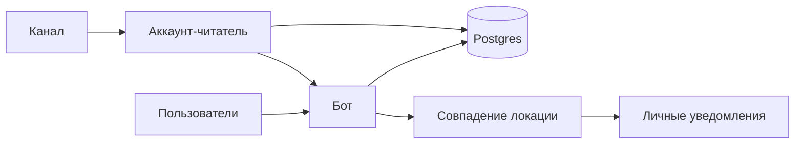

# Локатор России

Telegram-бот читает канал с оповещениями о БПЛА и присылает их тем, кто подписан на совпавшую локацию.

Пользователи, локации и сессия читателя канала лежат в Postgres. На диске сервера бот ничего не хранит: Render при деплое стирает файлы, поэтому секреты приходят из переменных окружения, а обновления сессии пишутся в базу.



## Команды

| Команда | Что делает |
| --- | --- |
| `/start` | Регистрация и главное меню |
| `/settings` | Локации и выключатель уведомлений |
| `/error` | Сообщение администратору |

Дальше всё на кнопках: список локаций, пауза уведомлений, поддержка проекта. Админское меню внутри бота открывается только если у пользователя в базе стоит флаг `admin`. `ADMIN_TELEGRAM_ID` — это отдельный чат для служебных ошибок и команды `/error`.

## Локальный запуск

Нужны Go 1.26 и Postgres.

```bash
cp example.env .env
go run ./cmd/bot
```

Проверка живости: [http://127.0.0.1:3000/api/app](http://127.0.0.1:3000/api/app) отвечает `{"message":"Hello World!"}`.

```bash
make test
make build
make migrate
```

`make migrate` и старт бота накатывают одни и те же миграции. Версии лежат в `locator_schema_migrations`, отдельно от других проектов в той же базе.

## Переменные

Скопируйте [`example.env`](example.env). Пустые значения бот не примет.

| Переменная | Зачем |
| --- | --- |
| `TELEGRAM_TOKEN` | Токен бота |
| `API_ID`, `API_HASH` | Приложение на [my.telegram.org](https://my.telegram.org) для аккаунта, который читает канал |
| `TG_SESSION` | Сессия этого аккаунта. Как получить — ниже |
| `CHANNEL` | Username канала без `@` |
| `ADMIN_TELEGRAM_ID` | Куда слать служебные ошибки и `/error` |
| `POSTGRES_HOST` | Хост базы |
| `POSTGRES_PORT` | Порт. Для Aiven это не 5432 |
| `POSTGRES_USER` | Пользователь |
| `POSTGRES_PASSWORD` | Пароль |
| `POSTGRES_DATABASE` | Имя базы |

К `localhost` бот ходит без SSL. К любому другому хосту — с `sslmode=require`, файл сертификата не нужен.

Необязательные переменные, если устраивают значения по умолчанию:

| Переменная | По умолчанию |
| --- | --- |
| `PORT` | Render подставляет сам. Бот слушает его, если `HTTP_ADDR` пуст |
| `HTTP_ADDR` | `:3000`, когда нет и `PORT` |
| `POLL_INTERVAL` | `2m` |
| `KEEPALIVE_INTERVAL` | `3m` |
| `KEEPALIVE_FAIL_ALERT` | `3` |

`KEEPALIVE_INTERVAL` — реальные запись, обновление и удаление в `db_keep_alive`, чтобы Aiven не засыпал.

## Сессия читателя

GramJS-строку сюда подставить нельзя. Один раз войдите локально, скопируйте строку в `TG_SESSION` и больше телефон в окружении сервиса не нужен.

```bash
PHONE=+7... TG_PASSWORD=... go run ./cmd/login
```

Команда пришлёт код в Telegram и напечатает `TG_SESSION=...`. При старте бот кладёт её в таблицу `tg_session`, если строки ещё нет. Пока переменная не менялась, из базы берётся более свежая копия. Новое значение `TG_SESSION` заменяет старую запись.

`PHONE` и `TG_PASSWORD` нужны только этой команде.

## Docker и Render

```bash
docker compose up --build
```

На Render сервис собирается из [`Dockerfile`](Dockerfile). В настройках не задавайте `HTTP_ADDR`: платформа передаёт `PORT`, образ слушает его. Health check — `GET /api/app`. Готовый набор переменных без секретов лежит в [`render.yaml`](render.yaml).

Не запускайте два процесса с одним `TELEGRAM_TOKEN`. Второй заберёт апдейты у первого.
